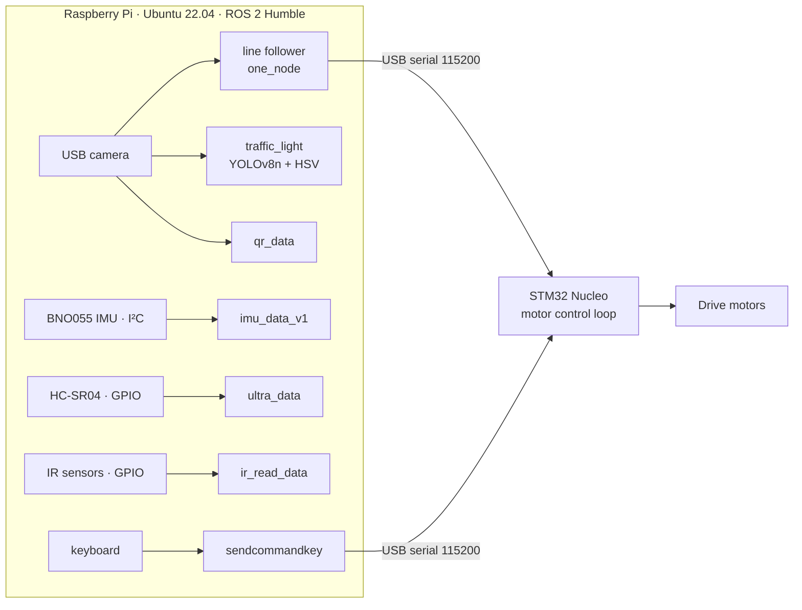

# Rocker-Bogie Rover (ROS 2 + STM32)

A six-wheel rocker-bogie rover that splits the work between two computers. A Raspberry Pi runs ROS 2 for sensing and vision, and an STM32 Nucleo handles real-time motor control. The two talk over USB serial.

<!--
MEDIA: drop files into docs/media/ and uncomment these lines.

[▶ Demo video (YouTube)](https://youtu.be/YOUR_VIDEO_ID)
-->

## What it does

- **Rough-terrain mobility:** the rocker-bogie suspension climbs 4 cm steps and crosses 4 cm ditches with no active suspension control.
- **Camera line following:** OpenCV thresholds the line in HSV, finds its centroid and sends steering commands to the STM32 at 10 Hz.
- **Traffic-light detection:** YOLOv8n finds traffic lights (COCO class 9), and HSV masks classify each one as red, yellow or green.
- **QR code reading:** OpenCV's `QRCodeDetector` decodes codes and publishes their contents.
- **Sensors:** a BNO055 IMU over I²C, an HC-SR04 ultrasonic rangefinder and two IR obstacle sensors on the Pi's GPIO.
- **Teleop and visualization:** keyboard driving, plus IMU orientation published as TF for RViz.

## System architecture



### ROS 2 topics

| Topic | Type | Publisher |
|---|---|---|
| `imu_data` | `sensor_msgs/Imu` | `imu_data_v1` |
| `distance_topic` | `std_msgs/String` | `ultra_data` |
| `/ir_data_topic` | `std_msgs/String` | `ir_read_data` |
| `qr_data` | `std_msgs/String` | `qr_data` |
| `traffic_light_topic` | `std_msgs/String` | `traffic_light` |
| `/cmd_vel` | `geometry_msgs/Twist` | `keyboard`, `rviz` |
| `motor_vel` | `std_msgs/Float32MultiArray` | `camfollow_mtr` |

### Serial protocol (Pi → STM32)

Single ASCII characters at 115200 baud on `/dev/ttyACM0`:

| Command | Action |
|---|---|
| `1` | Turn left |
| `2` | Turn right |
| `3` | Forward |
| `0` / `x` | Stop |

`SerialSimple.setMotorSpeed()` also supports a speed format, `"<left>/<right>/d"`.

## Repository layout

```
src/
├── mbedros2/      # serial bridge to the STM32: teleop, line follower, motor commands
├── ml3_ros2/      # sensor and vision nodes (IMU, ultrasonic, IR, QR, traffic light)
└── ml3_bringup/   # launch files
docs/media/        # photos, wiring diagram, demo video thumbnails
```

## Hardware

| Part | Role |
|---|---|
| Raspberry Pi (Ubuntu 22.04) | ROS 2 host, vision, sensors |
| STM32 Nucleo | Real-time motor control |
| BNO055 9-DoF IMU | Orientation (I²C) |
| HC-SR04 | Range (TRIG BCM 18, ECHO BCM 24) |
| 2× IR obstacle sensors | Left/right detection (GPIO) |
| USB camera | Line following, QR, traffic lights |
| DC drive motors + driver | Six-wheel rocker-bogie drivetrain |

<!-- Add the wiring diagram:  -->

## Build and run

```bash
# on the Pi, with ROS 2 Humble installed
git clone https://github.com/mmfaizanhossain/Rocker-bogie.git ~/rover_ws   # the repo is the workspace
cd ~/rover_ws
pip install pyserial ultralytics adafruit-circuitpython-bno055 RPi.GPIO
rosdep install --from-paths src -y --ignore-src
colcon build --symlink-install
source install/setup.bash

ros2 launch ml3_bringup launch.py      # QR code reader + subscriber
ros2 launch ml3_bringup launch2.py     # traffic-light detector + subscriber
ros2 run mbedros2 sendcommandkey       # keyboard teleop over serial
```

Some nodes are commented out in `setup.py`. Uncomment their `console_scripts` entries to run them.

## Roadmap

- [ ] Add the STM32 firmware (`firmware/`)
- [ ] Wheel encoders for odometry
- [ ] URDF and Gazebo simulation
- [ ] 2D lidar + `slam_toolbox` mapping
- [ ] Nav2 autonomous navigation to goal poses

## Credits

The `mbedros2` package started from [chadvedar/mbedROS2-motorsCTRL](https://github.com/chadvedar/mbedROS2-motorsCTRL) (Apache-2.0). Its original notes are in `src/mbedros2/UPSTREAM.md`.

## Author

**Faizan Hossain**, B.E. Mechatronics, Kyoto University of Advanced Science · [LinkedIn](https://www.linkedin.com/in/faizan-hossain/)
